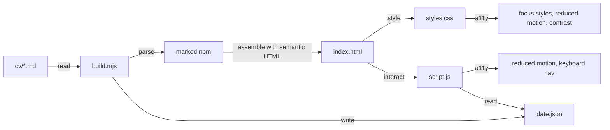

# Requirements

### Overview & Goals

Create a structured CV data store and a portfolio website for Gabriel Romay that:

1. Stores CV data in multiple Markdown files for easy editing
2. Builds to static HTML via a local script (no runtime Markdown fetching)
3. Displays as a professional portfolio website with timeline-style experience
4. Deploys to GitHub Pages for free hosting
5. Meets **WCAG 2.1 AA** accessibility standards

### Scope

**In Scope:**

- Create a `cv/` folder with Markdown files for each CV section (personal, summary, experience per company, skills, education, languages)
- Local build script that converts Markdown to HTML and generates meta tags
- Static HTML/CSS/JS portfolio website with timeline-style experience layout
- Sticky sidebar navigation with smooth scroll and active section highlighting
- Dark mode with toggle and auto-detection
- GitHub Pages deployment
- Tag cloud display for skills categories
- **WCAG 2.1 AA accessibility**: skip navigation, semantic HTML, ARIA landmarks, keyboard navigation, custom focus styles, `prefers-reduced-motion` support, color contrast compliance
- **Lighthouse accessibility audit** as part of validation

**Out of Scope:**

- PDF generation from Markdown files (existing PDFs in `pdfs/` remain as-is)
- Multi-language support (English only)
- Backend or database
- Blog or additional content beyond CV/portfolio
- GitHub Actions workflow for commit date (build script handles it)
- WCAG 2.1 AAA (AA is the target)

### User Stories

- As a developer, I want to edit my CV in separate Markdown files so I can update individual sections quickly
- As a developer, I want a local build script to convert Markdown to HTML so I don't need a complex build pipeline
- As a job seeker, I want a portfolio website that displays my CV with a professional timeline layout
- As a maintainer, I want the site to deploy to GitHub Pages so I don't need manual hosting
- **As a user with a screen reader, I want semantic HTML and ARIA landmarks so I can navigate the portfolio efficiently**
- **As a keyboard user, I want a skip navigation link and visible focus indicators so I can navigate without a mouse**
- **As a user with vestibular disorders, I want animations disabled when my system prefers reduced motion**

### Functional Requirements

1. **CV Data Files**: Split into Markdown files by section; each work experience in its own file in `cv/experience/` with numeric prefixes.

2. **Build Script**: Local Node.js script that converts all `cv/*.md` to HTML fragments, generates `index.html` with meta tags from CV data, and writes the current date to `date.json`. Wraps each section with **semantic HTML elements** (nav, main, section, article, aside, footer) and proper **heading hierarchy** (h1-h2-h3).

3. **Portfolio Website**: Static HTML/CSS/JS. Timeline-style experience layout. Tag cloud for skills. Sticky sidebar navigation with smooth scroll. Dark mode toggle. System fonts. Responsive design.

4. **Contact Info**: Email as mailto link, GitHub and LinkedIn links, 'Open to remote positions' note. No phone number for privacy.

5. **GitHub Pages**: Simple settings — enable Pages in repo settings, point to main branch root.

6. **Accessibility (WCAG 2.1 AA)**:
   - Skip navigation link (visible on focus, jumps to main content)
   - Semantic HTML structure with ARIA landmarks
   - Keyboard navigation for all interactive elements
   - Custom focus indicators (visible in both light and dark modes)
   - `prefers-reduced-motion` support (disables smooth scroll and animations)
   - Color contrast ratios meeting WCAG AA (4.5:1 for normal text, 3:1 for large text)
   - Skills tags distinguishable by more than color alone (WCAG 1.4.1)
   - Dark mode toggle labeled with aria-pressed or aria-checked

### Non-Functional Requirements

- **Performance**: No runtime Markdown fetching; all content pre-rendered to static HTML
- **Accessibility**: WCAG 2.1 AA compliance validated via Lighthouse audit
- **Responsive**: Works on mobile, tablet, and desktop
- **Dark Mode**: Follows system preference, user override persisted in localStorage

# Technical Design

### Current Implementation

The project is essentially empty:
- `README.md` — describes a static portfolio
- `pdfs/` — contains two CV PDFs (English and Spanish)
- `docs/` — agent documentation only
- No website code, no structured CV data file

### Key Decisions (from grilling sessions)

1. **Pre-render to HTML via local script** (changed from runtime Markdown fetch): A local Node.js script using `marked` converts all `cv/*.md` to HTML fragments and assembles `index.html` with meta tags. No runtime fetches, no CDN dependency. Faster page loads, but requires running the build script before pushing.

2. **Build script writes date.json** (changed from GitHub Actions workflow): The local build script writes the current date to `date.json` before you push. No workflow needed.

3. **Timeline-style experience layout**: Vertical timeline with dates on the left and content cards on the right. Professional and scannable.

4. **Tag cloud for skills**: Each skill category has a heading with skills displayed as small tags/chips below. Compact and scannable.

5. **Sticky sidebar with smooth scroll**: Sidebar stays visible while scrolling, clicking a section smoothly scrolls to it. Active section highlighted via scroll spy.

6. **Dark mode toggle + auto-detect**: Toggle button (sun/moon icon) in header or sidebar. Auto-detects system preference on first visit, user can override. Persists in localStorage.

7. **Mailto link + remote note**: Email as clickable mailto link. 'Open to remote positions' note under the title.

8. **Static meta tags from build**: Page title and meta description are generated by the build script from CV data and written into `index.html`.

9. **WCAG 2.1 AA accessibility** (new): Target WCAG 2.1 AA compliance. Includes skip navigation, semantic HTML, ARIA landmarks, keyboard navigation, custom focus styles, `prefers-reduced-motion` support, and color contrast compliance.

10. **Semantic HTML wrapper in build script** (new): The build script wraps each section with proper semantic elements and heading hierarchy. Ensures screen reader compatibility from the generated HTML.

11. **Lighthouse audit for validation** (new): Run a Lighthouse accessibility audit on the generated `index.html` before deployment to catch automated a11y issues.

### Proposed Changes

1. **Create `cv/` folder** with individual Markdown files:
   - `cv/personal.md` — name, title, location, contact (email as mailto, GitHub, LinkedIn; no phone; 'Open to remote positions')
   - `cv/summary.md` — professional summary
   - `cv/experience/01-stuart.md` through `04-edreams.md` — work experience (reverse chronological)
   - `cv/skills.md` — 10 categorized skill sections
   - `cv/education.md` — education history
   - `cv/languages.md` — language proficiency

2. **Create build script** (`build.mjs`):
   - Node.js script using `marked` package
   - Reads all `cv/*.md` files
   - Converts Markdown to HTML fragments
   - Wraps each section with **semantic HTML** (nav, main, section, article, aside, footer) and **ARIA landmarks**
   - Ensures **heading hierarchy** (h1 for page title, h2 for section headings, h3 for subsections)
   - Assembles `index.html` from a template, injecting HTML fragments and meta tags
   - Writes current date to `date.json`
   - Outputs to project root

3. **Create portfolio website** (generated by build script):
   - `index.html` — generated from template, with semantic structure, sticky sidebar nav, SEO meta tags, Open Graph tags, **skip navigation link**, **ARIA landmarks**
   - `styles.css` — timeline layout, tag cloud for skills, CSS custom properties, responsive design, dark mode, system fonts, **custom focus indicators**, **`prefers-reduced-motion` support**, **color contrast compliance**
   - `script.js` — dark mode toggle with localStorage, smooth scroll, scroll spy for active section highlighting, reads `date.json` for footer, **`prefers-reduced-motion` detection**, **keyboard navigation support**

4. **Update `README.md`** with project structure and build/deploy instructions.

### File Structure

```
portfolio/
├── cv/                                # CV data (source of truth)
│   ├── personal.md
│   ├── summary.md
│   ├── experience/
│   │   ├── 01-stuart.md
│   │   ├── 02-rakuten.md
│   │   ├── 03-habitissimo.md
│   │   └── 04-edreams.md
│   ├── skills.md
│   ├── education.md
│   └── languages.md
├── build.mjs                          # Local build script (Node.js + marked)
├── index.html                         # Generated by build script
├── styles.css                         # Website styles
├── script.js                          # Client-side interactivity
├── date.json                          # Written by build script
├── README.md                          # Updated docs
├── pdfs/                              # Existing CV PDFs (unchanged)
└── docs/                              # Existing agent docs (unchanged)
```

### Architecture Diagram



### Risks

- **Build script dependency**: Requires Node.js to run the build script. User needs to remember to run it before pushing.
- **Template maintenance**: The HTML template in `build.mjs` needs to be kept in sync with CSS classes and JS selectors.
- **Markdown structure consistency**: Each CV file must follow a consistent Markdown structure for the rendered HTML to look good in the timeline layout.
- **date.json on first build**: Before the first build run, `date.json` won't exist. The website should handle this gracefully.
- **Color contrast in dark mode**: Dark mode color palette must be carefully chosen to maintain WCAG AA contrast ratios (4.5:1 for normal text). Needs validation with a contrast checker.
- **Skills tag distinguishability**: Tags must be distinguishable by more than color alone (e.g., shape, icon, or text label) to meet WCAG 1.4.1.

# Testing

### Validation Approach

The agent will validate by running the build script and checking the output locally, including a Lighthouse accessibility audit.

### Key Scenarios

1. **Build script**: Run `node build.mjs` and verify that `index.html` is generated with correct content from all CV files.
2. **HTML structure**: Open `index.html` in a browser and verify all sections render correctly (header, summary, experience timeline, skills tag cloud, education, languages, footer).
3. **Semantic HTML**: Verify the generated HTML uses proper semantic elements (nav, main, section, article, aside, footer) and heading hierarchy (h1-h2-h3).
4. **ARIA landmarks**: Verify ARIA landmarks are present and correctly labeled.
5. **Dark mode**: Toggle dark mode and verify it persists across page reloads (localStorage).
6. **Responsive design**: Resize browser to mobile width and verify sidebar collapses, timeline adapts, and skills grid collapses.
7. **Smooth scroll**: Click navigation links and verify smooth scrolling to sections.
8. **Scroll spy**: Scroll through the page and verify active section is highlighted in the sidebar.
9. **Footer date**: Verify `date.json` is written by the build script and the footer displays the date.
10. **Skip navigation**: Tab to the skip link and verify it jumps to the main content area.
11. **Keyboard navigation**: Navigate the entire page using only the keyboard (Tab, Shift+Tab, Enter, Space, Arrow keys).
12. **Focus indicators**: Verify custom focus indicators are visible on all interactive elements in both light and dark modes.
13. **Reduced motion**: Set `prefers-reduced-motion: reduce` in browser dev tools and verify smooth scroll and animations are disabled.
14. **Color contrast**: Verify text color contrast ratios meet WCAG AA (4.5:1 for normal text, 3:1 for large text) in both light and dark modes.
15. **Lighthouse audit**: Run a Lighthouse accessibility audit on `index.html` and verify a score of 90+ (target 100).

### Edge Cases

- Missing CV file: Build script should handle missing files gracefully (error message or skip).
- Missing `date.json`: Website should omit the 'last updated' date if the file doesn't exist.
- Empty skill category: Skills section should handle categories with no skills gracefully.
- **Screen reader**: Test with a screen reader (NVDA, VoiceOver, or JAWS) to verify the page is navigable and content is announced correctly.
- **High contrast mode**: Verify the portfolio works in Windows High Contrast mode and macOS Increase Contrast.

# Delivery Steps

###   Step 1: Create cv/ folder with Markdown files
Extract CV data from the PDF and create structured Markdown files.
- Create `cv/` folder and `cv/experience/` subfolder
- Create `cv/personal.md` with name, title, location, contact (mailto email, GitHub, LinkedIn; 'Open to remote positions')
- Create `cv/summary.md` with professional summary
- Create `cv/experience/01-stuart.md` through `04-edreams.md` with consistent structure (header, company description, tech stack, key contributions, optional technical leadership)
- Create `cv/skills.md` with 10 categorized skill sections
- Create `cv/education.md` and `cv/languages.md`

###   Step 2: Create build script with semantic HTML and generate index.html
Build the local Node.js script that converts Markdown to HTML with semantic wrappers and assembles the website.
- Create `build.mjs` with `marked` dependency
- Implement Markdown-to-HTML conversion for all CV files
- Wrap each section with semantic HTML elements (nav, main, section, article, aside, footer) and ARIA landmarks
- Ensure heading hierarchy (h1 for page title, h2 for section headings, h3 for subsections)
- Create HTML template with skip navigation link, section placeholders, SEO meta tags, and Open Graph tags
- Inject rendered HTML fragments into the template
- Write current date to `date.json`
- Run the script to generate `index.html` and verify output

###   Step 3: Build the static portfolio website with a11y
Create the CSS and client-side JavaScript for the portfolio with full WCAG 2.1 AA accessibility.
- Create `styles.css` with timeline layout for experience, tag cloud for skills, CSS custom properties, responsive design, dark mode, system fonts, sticky sidebar styling
- Add **custom focus indicators** (visible in both light and dark modes)
- Add **`prefers-reduced-motion`** CSS media query to disable animations
- Ensure **color contrast** meets WCAG AA (4.5:1 for normal text, 3:1 for large text) in both modes
- Skills tags distinguishable by more than color alone (e.g., border style or icon)
- Create `script.js` with dark mode toggle (localStorage persistence), smooth scroll, scroll spy for active section highlighting, `date.json` fetch for footer
- Add **`prefers-reduced-motion` detection** in JS to disable smooth scroll when preferred
- Add **keyboard navigation** support for all interactive elements
- Test locally: verify all sections render, dark mode works, responsive layout, smooth scroll, scroll spy, skip link, keyboard nav, focus indicators, reduced motion

###   Step 4: Validate accessibility and finalize deployment
Run accessibility validation and finalize deployment documentation.
- Run a **Lighthouse accessibility audit** on `index.html` and verify a score of 90+ (target 100)
- Fix any a11y issues found by Lighthouse
- Update `README.md` with project structure, build instructions (`node build.mjs`), and GitHub Pages deployment steps
- Add `.gitignore` for node_modules if needed
- Verify the generated `index.html` is valid and complete