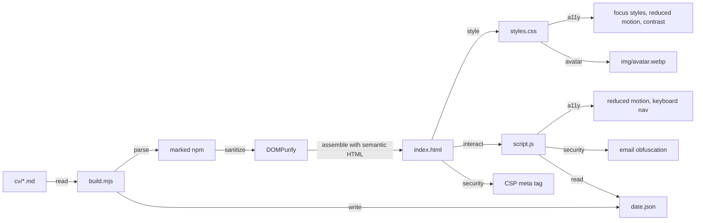

# Requirements

### Overview & Goals

Create a structured CV data store and a portfolio website for Gabriel Romay that:

1. Stores CV data in multiple Markdown files for easy editing
2. Builds to static HTML via a local script (no runtime Markdown fetching)
3. Displays as a professional portfolio website with timeline-style experience
4. Deploys to GitHub Pages for free hosting
5. Meets **WCAG 2.1 AA** accessibility standards
6. Implements **comprehensive security measures** to protect against XSS, scraping, and privacy leaks
7. Follows **privacy-by-design** principles for contact data handling
8. Includes an **avatar image** in the header/hero section for personal branding

### Scope

**In Scope:**

- Create a `cv/` folder with Markdown files for each CV section (personal, summary, experience per company, skills, education, languages)
- Local build script that converts Markdown to HTML and generates meta tags
- Static HTML/CSS/JS portfolio website with timeline-style experience layout
- Sticky sidebar navigation with smooth scroll and active section highlighting
- Dark mode with toggle and auto-detection
- GitHub Pages deployment
- Tag cloud display for skills categories
- **Avatar image** in the header/hero section (WebP, circular, 120x120, `role="presentation"`)
- **WCAG 2.1 AA accessibility**: skip navigation, semantic HTML, ARIA landmarks, keyboard navigation, custom focus styles, `prefers-reduced-motion` support, color contrast compliance
- **Lighthouse accessibility audit** as part of validation
- **Security measures**: XSS prevention (marked sanitization + DOMPurify), Content Security Policy (moderate), email obfuscation (JavaScript), PDF privacy (gitignore)
- **Privacy measures**: Email obfuscation, no phone number in portfolio, no tracking/analytics, PDFs excluded from public repo

**Out of Scope:**

- PDF generation from Markdown files
- Multi-language support (English only)
- Backend or database
- Blog or additional content beyond CV/portfolio
- GitHub Actions workflow for commit date (build script handles it)
- WCAG 2.1 AAA (AA is the target)
- Contact form (would require backend)
- Analytics or tracking (privacy-first approach)
- Real photo (avatar only, no biometric data)

### User Stories

- As a developer, I want to edit my CV in separate Markdown files so I can update individual sections quickly
- As a developer, I want a local build script to convert Markdown to HTML so I don't need a complex build pipeline
- As a job seeker, I want a portfolio website that displays my CV with a professional timeline layout
- As a maintainer, I want the site to deploy to GitHub Pages so I don't need manual hosting
- **As a visitor, I want to see an avatar in the header so the portfolio feels personal and professional**
- **As a user with a screen reader, I want semantic HTML and ARIA landmarks so I can navigate the portfolio efficiently**
- **As a keyboard user, I want a skip navigation link and visible focus indicators so I can navigate without a mouse**
- **As a user with vestibular disorders, I want animations disabled when my system prefers reduced motion**
- **As a site owner, I want protection against XSS attacks so my portfolio is secure**
- **As a site owner, I want my email obfuscated so bots can't scrape it**
- **As a site owner, I want sensitive data (PDFs) excluded from the public repo**
- **As a site owner, I want no phone number on the public portfolio to avoid spam calls**
- **As a visitor, I want the portfolio to not track my activity so my privacy is respected**

### Functional Requirements

1. **CV Data Files**: Split into Markdown files by section; each work experience in its own file in `cv/experience/` with numeric prefixes.

2. **Build Script**: Local Node.js script that converts all `cv/*.md` to HTML fragments, generates `index.html` with meta tags from CV data, and writes the current date to `date.json`. Wraps each section with **semantic HTML elements** (nav, main, section, article, aside, footer) and proper **heading hierarchy** (h1-h2-h3). **Sanitizes Markdown output using marked's built-in sanitizer and DOMPurify for defense in depth.**

3. **Portfolio Website**: Static HTML/CSS/JS. Timeline-style experience layout. Tag cloud for skills. Sticky sidebar navigation with smooth scroll. Dark mode toggle. System fonts. Responsive design.

4. **Avatar Image**:
   - Placed in the **header/hero section** next to the name and title
   - Format: **WebP**, circular crop, **120x120 pixels**
   - Accessibility: `role="presentation"` (decorative, hidden from screen readers)
   - Stored in the repo as an optimized version; original high-res image kept private

5. **Contact Info (Privacy-Conscious)**:
   - Email as **obfuscated JavaScript-generated mailto link** (to prevent scraping)
   - GitHub and LinkedIn profile links
   - 'Open to remote positions' note
   - **No phone number** (excluded from portfolio for privacy, kept in local PDFs only)
   - Location: "Palma de Mallorca, Spain" (city-level, public)

6. **GitHub Pages**: Simple settings — enable Pages in repo settings, point to main branch root.

7. **Accessibility (WCAG 2.1 AA)**:
   - Skip navigation link (visible on focus, jumps to main content)
   - Semantic HTML structure with ARIA landmarks
   - Keyboard navigation for all interactive elements
   - Custom focus indicators (visible in both light and dark modes)
   - `prefers-reduced-motion` support (disables smooth scroll and animations)
   - Color contrast ratios meeting WCAG AA (4.5:1 for normal text, 3:1 for large text)
   - Skills tags distinguishable by more than color alone (WCAG 1.4.1)
   - Dark mode toggle labeled with aria-pressed or aria-checked

8. **Security**:
   - **XSS Prevention**: Sanitize all Markdown output using marked's built-in sanitizer and DOMPurify library
   - **Content Security Policy**: Moderate CSP via `<meta>` tag allowing same-origin scripts and trusted sources
   - **Email Obfuscation**: JavaScript-generated mailto link to prevent bot scraping

9. **Privacy**:
   - **No phone number** in the public portfolio (kept in local PDFs only)
   - **No tracking or analytics** (zero visitor data collection)
   - **PDFs excluded from public repo** via `.gitignore` (contains phone number and full address)
   - **Email obfuscation** to prevent scraping
   - **Data minimization**: Only essential contact info exposed (email, GitHub, LinkedIn, city-level location)

### Non-Functional Requirements

- **Performance**: No runtime Markdown fetching; all content pre-rendered to static HTML
- **Accessibility**: WCAG 2.1 AA compliance validated via Lighthouse audit
- **Security**: XSS protection, CSP, email obfuscation, and PDF privacy
- **Privacy**: No tracking, no phone number public, email obfuscated, PDFs private
- **Responsive**: Works on mobile, tablet, and desktop
- **Dark Mode**: Follows system preference, user override persisted in localStorage

# Technical Design

### Current Implementation

The project is essentially empty:

- `README.md` — describes a static portfolio
- `docs/` — agent documentation only
- No website code, no structured CV data file

### Key Decisions (from grilling sessions)

1. **Pre-render to HTML via local script** (changed from runtime Markdown fetch): A local Node.js script using `marked` converts all `cv/*.md` to HTML fragments and assembles `index.html` with meta tags. No runtime fetches, no CDN dependency. Faster page loads, but requires running the build script before pushing.

2. **Build script writes date.json** (changed from GitHub Actions workflow): The local build script writes the current date to `date.json` before you push. No workflow needed.

3. **Timeline-style experience layout**: Vertical timeline with dates on the left and content cards on the right. Professional and scannable.

4. **Tag cloud for skills**: Each skill category has a heading with skills displayed as small tags/chips below. Compact and scannable.

5. **Sticky sidebar with smooth scroll**: Sidebar stays visible while scrolling, clicking a section smoothly scrolls to it. Active section highlighted via scroll spy.

6. **Dark mode toggle + auto-detect**: Toggle button (sun/moon icon) in header or sidebar. Auto-detects system preference on first visit, user can override. Persists in localStorage.

7. **Mailto link + remote note**: Email as clickable mailto link. 'Open to remote positions' note under the title.

8. **Static meta tags from build**: Page title and meta description are generated by the build script from CV data and written into `index.html`.

9. **WCAG 2.1 AA accessibility** (new): Target WCAG 2.1 AA compliance. Includes skip navigation, semantic HTML, ARIA landmarks, keyboard navigation, custom focus styles, `prefers-reduced-motion` support, and color contrast compliance.

10. **Semantic HTML wrapper in build script** (new): The build script wraps each section with proper semantic elements and heading hierarchy. Ensures screen reader compatibility from the generated HTML.

11. **Lighthouse audit for validation** (new): Run a Lighthouse accessibility audit on the generated `index.html` before deployment to catch automated a11y issues.

12. **XSS Prevention with marked + DOMPurify** (new): Use marked's built-in sanitizer and DOMPurify library for defense in depth against XSS attacks via Markdown.

13. **Moderate CSP** (new): Add a `<meta>` tag with Content Security Policy allowing same-origin scripts and trusted sources. Balanced security and functionality.

14. **JavaScript email obfuscation** (new): Generate the mailto link in JavaScript to prevent bot scraping of the email address.

15. **No phone number in portfolio** (privacy grilling): Exclude phone number from the public portfolio entirely. Keep it only in the local CV PDFs (which are gitignored) for direct sharing with recruiters. Protects against spam calls and number scraping.

16. **No tracking or analytics** (privacy grilling): Keep the portfolio completely free of tracking. No cookies, no analytics, no visitor data collection. Maximum visitor privacy, zero compliance overhead.

17. **LinkedIn and GitHub links included** (privacy grilling): Include both LinkedIn and GitHub profile links as they are standard for developer portfolios and expected by recruiters. Accept the privacy trade-off for professional visibility.

18. **City-level location** (privacy grilling): Show "Palma de Mallorca, Spain" — standard for CVs, helpful for local opportunities, low privacy risk.

19. **Avatar image, not real photo** (image grilling): Use an avatar image instead of a real photo for privacy. The avatar is placed in the header/hero section, formatted as WebP (circular, 120x120), and marked as decorative (`role="presentation"`) for screen readers. The optimized avatar is stored in the repo; the original high-res image is kept private.

20. **package.json for dependencies** (Twelve-Factor grilling): Create a `package.json` that explicitly declares `marked` and `dompurify` as dependencies. Run `npm install` before `node build.mjs`. Follows Twelve-Factor Factor II — explicitly declare and isolate dependencies.

21. **Build output to dist/ folder** (Twelve-Factor grilling): The build script writes all generated files (`index.html`, `styles.css`, `script.js`, `date.json`, `img/`) to a `dist/` directory, keeping source and build artifacts separate. Follows Twelve-Factor Factor V — strictly separate build, release, and run.

22. **Local preview command** (Twelve-Factor grilling): Add a `preview` script to `package.json` that serves the built files locally (e.g., `npx serve dist`). Minimizes the gap between dev and prod. Follows Twelve-Factor Factor X — dev/prod parity.

### Proposed Changes

1. **Create `cv/` folder** with individual Markdown files:
   - `cv/personal.md` — name, title, location (Palma de Mallorca, Spain), contact (email as mailto, GitHub, LinkedIn; no phone; 'Open to remote positions')
   - `cv/summary.md` — professional summary
   - `cv/experience/01-stuart.md` through `04-edreams.md` — work experience (reverse chronological)
   - `cv/skills.md` — 10 categorized skill sections
   - `cv/education.md` — education history
   - `cv/languages.md` — language proficiency

2. **Create `package.json`** with dependency declarations:
   - Declare `marked` and `dompurify` as dependencies
   - Add `build` script: `node build.mjs`
   - Add `preview` script: `npx serve dist`

3. **Create build script** (`build.mjs`):
   - Node.js script using `marked` package and `dompurify` for sanitization
   - Reads all `cv/*.md` files
   - Converts Markdown to HTML fragments
   - **Sanitizes output using marked's built-in sanitizer and DOMPurify**
   - Wraps each section with **semantic HTML** (nav, main, section, article, aside, footer) and **ARIA landmarks**
   - Ensures **heading hierarchy** (h1 for page title, h2 for section headings, h3 for subsections)
   - Assembles `index.html` from a template, injecting HTML fragments and meta tags
   - Writes current date to `date.json`
   - **Outputs to `dist/` directory** (separates source from build artifacts)

4. **Create portfolio website** (generated by build script, output to `dist/`):
   - `dist/index.html` — generated from template, with semantic structure, sticky sidebar nav, SEO meta tags, Open Graph tags, **skip navigation link**, **ARIA landmarks**, **CSP meta tag**, **avatar image in header**
   - `dist/styles.css` — timeline layout, tag cloud for skills, CSS custom properties, responsive design, dark mode, system fonts, **custom focus indicators**, **`prefers-reduced-motion` support**, **color contrast compliance**, **avatar circular styling**
   - `dist/script.js` — dark mode toggle with localStorage, smooth scroll, scroll spy for active section highlighting, reads `date.json` for footer, **`prefers-reduced-motion` detection**, **keyboard navigation support**, **email obfuscation**

5. **Add avatar image** (`img/avatar.webp`):
   - WebP format, circular crop, 120x120 pixels
   - Referenced in the header/hero section of `index.html`
   - Styled with CSS for circular appearance
   - Marked with `role="presentation"` for accessibility
   - Copied to `dist/img/avatar.webp` during build

6. **Update `README.md`** with project structure and build/deploy instructions.

7. **Add `.gitignore`** to exclude `node_modules/`, `pdfs/`, and `dist/`.

### File Structure

```
portfolio/
├── cv/                                # CV data (source of truth)
│   ├── personal.md
│   ├── summary.md
│   ├── experience/
│   │   ├── 01-stuart.md
│   │   ├── 02-rakuten.md
│   │   ├── 03-habitissimo.md
│   │   └── 04-edreams.md
│   ├── skills.md
│   ├── education.md
│   └── languages.md
├── img/                               # Images (source, copied to dist/ on build)
│   └── avatar.webp                    # Avatar image (WebP, 120x120, circular)
├── dist/                              # Build output (gitignored)
│   ├── index.html                     # Generated by build script
│   ├── styles.css                     # Website styles
│   ├── script.js                      # Client-side interactivity
│   ├── date.json                      # Written by build script
│   └── img/
│       └── avatar.webp                # Copied from img/ during build
├── build.mjs                          # Local build script (Node.js + marked + dompurify)
├── package.json                       # Dependencies and scripts (build, preview)
├── .gitignore                         # Excludes pdfs/, node_modules/, dist/
├── README.md                          # Updated docs
├── pdfs/                              # Existing CV PDFs (gitignored, not public)
└── docs/                              # Existing agent docs (unchanged)
```

### Architecture Diagram



### Risks

- **Build script dependency**: Requires Node.js to run the build script. User needs to remember to run it before pushing.
- **Template maintenance**: The HTML template in `build.mjs` needs to be kept in sync with CSS classes and JS selectors.
- **Markdown structure consistency**: Each CV file must follow a consistent Markdown structure for the rendered HTML to look good in the timeline layout.
- **date.json on first build**: Before the first build run, `date.json` won't exist. The website should handle this gracefully.
- **Color contrast in dark mode**: Dark mode color palette must be carefully chosen to maintain WCAG AA contrast ratios (4.5:1 for normal text). Needs validation with a contrast checker.
- **Skills tag distinguishability**: Tags must be distinguishable by more than color alone (e.g., shape, icon, or text label) to meet WCAG 1.4.1.
- **DOMPurify dependency**: Adds a runtime dependency for sanitization. Need to ensure it's loaded correctly in the browser.
- **CSP compatibility**: The moderate CSP may block some legitimate scripts or resources. Need to test thoroughly.
- **Email obfuscation**: JavaScript-generated mailto link requires JS to be enabled. Users with JS disabled won't see the email link.
- **PDF privacy**: If PDFs are accidentally committed to the repo, the phone number and full address become public. The `.gitignore` must be verified before the first push.
- **Location exposure**: City-level location (Palma de Mallorca, Spain) is public. This is standard for CVs but adds identifying information.
- **Avatar image**: The avatar is in the public repo. Since it's an avatar (not a real photo), the privacy risk is low. The original high-res image should be kept private.
- **dist/ directory**: The `dist/` folder is gitignored. GitHub Pages must be configured to serve from the correct location (either `dist/` via a build step, or the built files committed to a separate branch).

# Testing

### Validation Approach

The agent will validate by running the build script and checking the output locally, including a Lighthouse accessibility audit, security checks, and privacy verification.

### Key Scenarios

1. **Build script**: Run `node build.mjs` and verify that `index.html` is generated with correct content from all CV files.
2. **HTML structure**: Open `index.html` in a browser and verify all sections render correctly (header with avatar, summary, experience timeline, skills tag cloud, education, languages, footer).
3. **Avatar rendering**: Verify the avatar image loads correctly in the header/hero section, appears circular, and is 120x120 pixels.
4. **Avatar accessibility**: Verify the avatar has `role="presentation"` and is hidden from screen readers.
5. **Semantic HTML**: Verify the generated HTML uses proper semantic elements (nav, main, section, article, aside, footer) and heading hierarchy (h1-h2-h3).
6. **ARIA landmarks**: Verify ARIA landmarks are present and correctly labeled.
7. **Dark mode**: Toggle dark mode and verify it persists across page reloads (localStorage).
8. **Responsive design**: Resize browser to mobile width and verify sidebar collapses, timeline adapts, and skills grid collapses.
9. **Smooth scroll**: Click navigation links and verify smooth scrolling to sections.
10. **Scroll spy**: Scroll through the page and verify active section is highlighted in the sidebar.
11. **Footer date**: Verify `date.json` is written by the build script and the footer displays the date.
12. **Skip navigation**: Tab to the skip link and verify it jumps to the main content area.
13. **Keyboard navigation**: Navigate the entire page using only the keyboard (Tab, Shift+Tab, Enter, Space, Arrow keys).
14. **Focus indicators**: Verify custom focus indicators are visible on all interactive elements in both light and dark modes.
15. **Reduced motion**: Set `prefers-reduced-motion: reduce` in browser dev tools and verify smooth scroll and animations are disabled.
16. **Color contrast**: Verify text color contrast ratios meet WCAG AA (4.5:1 for normal text, 3:1 for large text) in both light and dark modes.
17. **Lighthouse audit**: Run a Lighthouse accessibility audit on `index.html` and verify a score of 90+ (target 100).
18. **XSS prevention**: Attempt to inject malicious Markdown (e.g., `<script>` tags) and verify it's sanitized by marked and DOMPurify.
19. **CSP validation**: Verify the CSP meta tag is present and correctly configured. Test that it blocks unauthorized scripts.
20. **Email obfuscation**: Verify the email is not visible in the HTML source but is accessible via the mailto link in the browser.
21. **No phone number**: Verify the portfolio contains no phone number in the HTML or source code.
22. **No tracking**: Verify the portfolio contains no analytics scripts, cookies, or tracking mechanisms.
23. **PDF privacy**: Verify the `pdfs/` folder is excluded from the public repo via `.gitignore`.

### Edge Cases

- Missing CV file: Build script should handle missing files gracefully (error message or skip).
- Missing `date.json`: Website should omit the 'last updated' date if the file doesn't exist.
- Empty skill category: Skills section should handle categories with no skills gracefully.
- **Missing avatar**: Website should handle gracefully if `img/avatar.webp` is missing (e.g., show initials or placeholder).
- **Screen reader**: Test with a screen reader (NVDA, VoiceOver, or JAWS) to verify the page is navigable and content is announced correctly.
- **High contrast mode**: Verify the portfolio works in Windows High Contrast mode and macOS Increase Contrast.
- **XSS attack**: Test with malicious Markdown input to verify sanitization works.
- **CSP violations**: Test with scripts that should be blocked by CSP to verify enforcement.
- **Email scraping**: Test with common email scraping tools to verify obfuscation works.
- **Accidental PDF commit**: Verify that attempting to commit PDFs is prevented by `.gitignore`.

# Tickets Published

The spec has been broken into 5 tracer-bullet tickets, published as GitHub Issues (sub-issues of [#1](https://github.com/W01fw00d/portfolio/issues/1)):

| #   | Issue                                                | Title                                                      | Blocked By |
| --- | ---------------------------------------------------- | ---------------------------------------------------------- | ---------- |
| 1   | [#2](https://github.com/W01fw00d/portfolio/issues/2) | Set up project structure and CV data files                 | None       |
| 2   | [#3](https://github.com/W01fw00d/portfolio/issues/3) | Build portfolio shell with navigation, dark mode, and a11y | #2         |
| 3   | [#4](https://github.com/W01fw00d/portfolio/issues/4) | Add experience timeline and skills tag cloud               | #3         |
| 4   | [#5](https://github.com/W01fw00d/portfolio/issues/5) | Add education, languages, footer, and security hardening   | #4         |
| 5   | [#6](https://github.com/W01fw00d/portfolio/issues/6) | Validate, audit, and finalize deployment                   | #5         |

All tickets are labeled `ready-for-agent`. The dependency chain is linear: each ticket must complete before the next can start.

# Delivery Steps

### Step 1: Create cv/ folder with Markdown files

Extract CV data from the PDF and create structured Markdown files.

- Create `cv/` folder and `cv/experience/` subfolder
- Create `cv/personal.md` with name, title, location (Palma de Mallorca, Spain), contact (mailto email, GitHub, LinkedIn; 'Open to remote positions')
- Create `cv/summary.md` with professional summary
- Create `cv/experience/01-stuart.md` through `04-edreams.md` with consistent structure (header, company description, tech stack, key contributions, optional technical leadership)
- Create `cv/skills.md` with 10 categorized skill sections
- Create `cv/education.md` and `cv/languages.md`

### Step 2: Create package.json and build script with semantic HTML, sanitization, and generate index.html

Set up dependency management and build the local Node.js script that converts Markdown to HTML with semantic wrappers, sanitization, and assembles the website.

- Create `package.json` with `marked` and `dompurify` as dependencies
- Add `build` script: `node build.mjs`
- Add `preview` script: `npx serve dist`
- Run `npm install` to install dependencies
- Create `build.mjs`
- Implement Markdown-to-HTML conversion for all CV files
- **Sanitize output using marked's built-in sanitizer and DOMPurify**
- Wrap each section with semantic HTML elements (nav, main, section, article, aside, footer) and ARIA landmarks
- Ensure heading hierarchy (h1 for page title, h2 for section headings, h3 for subsections)
- Create HTML template with skip navigation link, section placeholders, SEO meta tags, Open Graph tags, **CSP meta tag**, and **avatar image reference**
- Inject rendered HTML fragments into the template
- Write current date to `date.json`
- **Output all generated files to `dist/` directory**
- Run the script to generate `dist/index.html` and verify output

### Step 3: Build the static portfolio website with a11y, security, and avatar

Create the CSS, client-side JavaScript, and avatar image for the portfolio with full WCAG 2.1 AA accessibility and security measures.

- Create `img/` folder and add `img/avatar.webp` (WebP, circular, 120x120, with `role="presentation"`)
- Create `styles.css` with timeline layout for experience, tag cloud for skills, CSS custom properties, responsive design, dark mode, system fonts, sticky sidebar styling
- Add **avatar circular styling** in CSS
- Add **custom focus indicators** (visible in both light and dark modes)
- Add **`prefers-reduced-motion`** CSS media query to disable animations
- Ensure **color contrast** meets WCAG AA (4.5:1 for normal text, 3:1 for large text) in both modes
- Skills tags distinguishable by more than color alone (e.g., border style or icon)
- Create `script.js` with dark mode toggle (localStorage persistence), smooth scroll, scroll spy for active section highlighting, `date.json` fetch for footer
- Add **`prefers-reduced-motion` detection** in JS to disable smooth scroll when preferred
- Add **keyboard navigation** support for all interactive elements
- Add **email obfuscation** using JavaScript to generate the mailto link
- Test locally: verify all sections render, avatar loads, dark mode works, responsive layout, smooth scroll, scroll spy, skip link, keyboard nav, focus indicators, reduced motion, email obfuscation
- **Test local preview**: Run `npm run preview` and verify the built site serves correctly

### Step 4: Validate accessibility, security, and finalize deployment

Run accessibility and security validation and finalize deployment documentation.

- Run a **Lighthouse accessibility audit** on `dist/index.html` and verify a score of 90+ (target 100)
- **Test XSS prevention** by injecting malicious Markdown and verifying sanitization
- **Verify CSP** is correctly configured and blocks unauthorized scripts
- **Verify email obfuscation** prevents scraping
- **Verify avatar** renders correctly and is hidden from screen readers
- Fix any a11y or security issues found
- Update `README.md` with project structure, build instructions (`npm run build`), preview instructions (`npm run preview`), and GitHub Pages deployment steps
- Add `.gitignore` for `node_modules/`, `pdfs/`, and `dist/`
- Verify the generated `dist/index.html` is valid and complete
