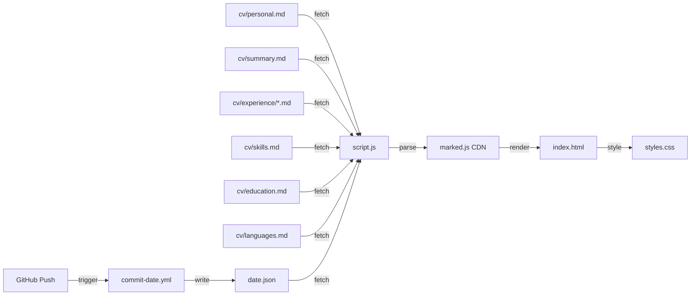

# Requirements

### Overview & Goals

Create a structured CV data store and a portfolio website for Gabriel Romay that:

1. Stores CV data in multiple Markdown files for easy editing without external tools
2. Displays the CV data as a professional portfolio website
3. Deploys to GitHub Pages for free hosting

### Scope

**In Scope:**

- Create a `cv/` folder with Markdown files for each CV section (personal, summary, experience per company, skills, education, languages)
- Build a static HTML/CSS/JS portfolio website that reads and renders the CV data
- Configure GitHub Pages deployment
- Update `README.md` with project documentation

**Out of Scope:**

- PDF generation from the Markdown files (the existing PDFs in `pdfs/` remain as-is)
- Multi-language support (English only for the website)
- Backend or database
- Blog or additional content beyond CV/portfolio

### User Stories

- As a developer, I want to edit my CV in separate Markdown files so I can update individual sections quickly without scrolling through a large file
- As a job seeker, I want a portfolio website that displays my CV so I can share it with potential employers
- As a maintainer, I want the site to deploy automatically to GitHub Pages so I don't need manual deployment steps

### Functional Requirements

1. **CV Data Files**:
   - Contains all information from the existing PDF: personal info, professional summary, work experience (4 positions), technical skills (categorized), education, and languages
   - Split into multiple Markdown files by section for easier editing
   - Each work experience entry gets its own file in `cv/experience/`
   - Structured with clear Markdown headings and lists
   - Single source of truth for all CV content

2. **Portfolio Website**:
   - Static HTML/CSS/JS — no build tools or framework dependencies
   - Renders CV data from the Markdown files (parsed at runtime via JavaScript)
   - Professional, clean design suitable for a senior developer portfolio
   - Responsive layout (mobile and desktop)
   - Sections: Header with contact info, Summary, Work Experience, Technical Skills, Education, Languages
   - Links to GitHub and LinkedIn profiles

3. **GitHub Pages Deployment**:
   - Configured via simple GitHub Pages settings (enable Pages in repo settings, point to main branch root)
   - A minimal GitHub Actions workflow writes the latest commit date to `date.json` on each push for the "last updated" footer
   - No build step needed for the static files themselves

# Grilling Decisions

### Decisions from Plan Review

The following decisions were made during the grilling process to refine the plan:

1. **Experience file ordering**: Files are named with numeric prefixes (01-stuart.md, 02-rakuten.md, 03-habitissimo.md, 04-edreams.md) in reverse chronological order (most recent first). Natural filesystem order matches display order.

2. **Dark mode**: Auto-detected via `prefers-color-scheme`, with a manual toggle button. The user's choice persists in `localStorage` so it survives page reloads.

3. **Skills layout**: Displayed in a 2-column grid on desktop, collapsing to 1 column on mobile. Saves vertical space and looks polished.

4. **Contact info**: Email and social links only (GitHub, LinkedIn). Phone number excluded from the public portfolio for privacy.

5. **GitHub Pages deployment**: Simple GitHub Pages settings (enable in repo settings, point to main branch root). No workflow for deploying static files since there's no build step.

6. **Last updated date**: A minimal GitHub Actions workflow writes the latest commit date to `date.json` on each push to main. The website fetches `date.json` at runtime and displays it in the footer. This is the only way to auto-infer the date without manual updates.

7. **SEO metadata**: Page title uses name and title from `cv/personal.md` (e.g., "Gabriel Romay — Senior Full-Stack Engineer"). Meta description uses a truncated version of `cv/summary.md`.

8. **Footer content**: GitHub and LinkedIn links, copyright line ("© Gabriel Romay"), and "Last updated" date from `date.json`.

9. **Color scheme**: Neutral professional — clean whites/grays with a blue accent. Professional and understated for a senior engineer.

10. **Navigation**: Sticky sidebar on desktop that collapses to a hamburger menu on mobile. Navigation stays visible while scrolling.

11. **Typography**: System fonts (`-apple-system, BlinkMacSystemFont, 'Segoe UI', Roboto, sans-serif`). Fast, no network request, clean on modern systems.

# Technical Design

### Current Implementation

The project is essentially empty:

- `README.md` — describes a static portfolio (updated from React)
- `pdfs/` — contains two CV PDFs (English and Spanish)
- `docs/` — agent documentation only
- No website code, no structured CV data file

### Key Decisions

1. **Multiple Markdown files as the data source**: Instead of a single `cv.md`, the CV data will be split into multiple files under a `cv/` folder. Each section gets its own file, and each work experience entry has its own file in `cv/experience/` with numeric prefixes for ordering. This makes it easier to edit individual parts without scrolling through a large document.

2. **Static HTML/CSS/JS (no build step)**: The site consists of `index.html`, `styles.css`, and `script.js`. No bundler, no framework. This keeps the project simple and deployable directly to GitHub Pages without a build pipeline.

3. **Markdown parsing approach**: The website will fetch all CV Markdown files and render them through `marked.js` (loaded from CDN). This means editing any CV file automatically updates the website — no build step needed.

4. **GitHub Pages via simple settings**: Enable Pages in repo settings pointing to the `main` branch root. No workflow needed for deploying static files since there's no build step. A minimal workflow exists only to write the commit date to `date.json`.

5. **Experience file ordering**: Files are named with numeric prefixes (01-stuart.md, 02-rakuten.md, 03-habitissimo.md, 04-edreams.md) in reverse chronological order. Natural filesystem order matches display order.

6. **Experience file template**: Each experience file will follow a consistent structure:
   - Job title, company, dates, and location as a header
   - Company description paragraph
   - Tech stack section
   - Key contributions and achievements (bulleted list)
   - Optional: Technical leadership section

7. **Dark mode with persistence**: Auto-detected via `prefers-color-scheme`, with a manual toggle. User's choice persists in `localStorage`.

8. **Neutral professional color scheme**: Clean whites/grays with a blue accent. Professional and understated for a senior engineer.

9. **Sticky sidebar navigation**: A sticky sidebar on desktop that collapses to a hamburger menu on mobile. Navigation stays visible while scrolling.

10. **System fonts**: `-apple-system, BlinkMacSystemFont, 'Segoe UI', Roboto, sans-serif`. Fast, no network request, clean on modern systems.

11. **2-column skills grid**: Skills displayed in a 2-column grid on desktop, collapsing to 1 column on mobile.

12. **Auto last updated date**: A minimal GitHub Actions workflow writes the latest commit date to `date.json` on each push. The website fetches it at runtime for the footer.

### Proposed Changes

1. **Create `cv/` folder** with individual Markdown files for each CV section:
   - `cv/personal.md` — name, title, location, contact info (email, GitHub, LinkedIn; no phone)
   - `cv/summary.md` — professional summary paragraph
   - `cv/experience/01-stuart.md` — Stuart Delivery position (most recent)
   - `cv/experience/02-rakuten.md` — Rakuten Japan position
   - `cv/experience/03-habitissimo.md` — Habitissimo position
   - `cv/experience/04-edreams.md` — eDreams Odigeo position (oldest)
   - `cv/skills.md` — technical skills (10 categories from PDF)
   - `cv/education.md` — education history
   - `cv/languages.md` — language proficiency

2. **Create the portfolio website**:
   - `index.html` — main page structure with semantic HTML sections, sticky sidebar navigation (hamburger on mobile), SEO meta tags, and Open Graph tags
   - `styles.css` — neutral professional styling (whites/grays with blue accent), CSS custom properties, responsive design, dark mode with `prefers-color-scheme` and manual toggle, 2-column skills grid, system fonts
   - `script.js` — fetches all CV files in parallel, parses them with marked.js (CDN), injects rendered HTML into the correct sections, dark mode toggle with localStorage persistence, fetches `date.json` for the "last updated" footer, error handling for failed fetches

3. **Configure GitHub Pages**:
   - Enable Pages in repo settings pointing to `main` branch root (simple settings, no deploy workflow)
   - `.github/workflows/commit-date.yml` — minimal workflow that writes the latest commit date to `date.json` on each push to main

4. **Update `README.md`** to reflect the actual project structure (cv/ folder) and deployment instructions.

### File Structure

```
portfolio/
├── cv/                                # CV data (split by section)
│   ├── personal.md                    # Name, title, location, contact
│   ├── summary.md                     # Professional summary
│   ├── experience/                    # Work experience (one file per company, prefixed)
│   │   ├── 01-stuart.md               # Stuart Delivery (most recent)
│   │   ├── 02-rakuten.md              # Rakuten Japan
│   │   ├── 03-habitissimo.md          # Habitissimo
│   │   └── 04-edreams.md              # eDreams Odigeo (oldest)
│   ├── skills.md                      # Technical skills
│   ├── education.md                   # Education
│   └── languages.md                   # Languages
├── index.html                         # Portfolio website
├── styles.css                         # Website styles
├── script.js                          # Markdown parsing and rendering
├── date.json                          # Auto-generated commit date (by workflow)
├── README.md                          # Updated project documentation
├── .github/
│   └── workflows/
│       └── commit-date.yml            # Writes commit date to date.json
├── pdfs/                              # Existing CV PDFs (unchanged)
└── docs/                              # Existing agent docs (unchanged)
```

### Architecture Diagram



### Risks

- **Multiple fetch requests**: The website needs to fetch 10 files (9 Markdown + 1 JSON). This adds a small overhead but is negligible for a static site. Files will be fetched in parallel using `Promise.all()`.
- **Markdown parsing**: The `marked.js` library renders Markdown to HTML. Each CV file's structure needs to be consistent so the rendered output looks good. We'll use a simple structure (headings, lists, bold text) that maps cleanly to HTML.
- **GitHub Pages base path**: If the repo is not the user's main profile page, the site will be served at `/repo-name/`. The `index.html` should use relative paths for assets.
- **Missing files**: If a CV file is missing or corrupted, the website should display a fallback message rather than breaking completely.
- **date.json not yet generated**: On the first visit before any workflow run, `date.json` won't exist. The website should handle this gracefully and omit the "last updated" date.

# Delivery Steps

### Step 1: Create cv/ folder with individual Markdown files
Extract CV data from the PDF and create separate Markdown files for each section.
- Create `cv/` folder at the project root
- Create `cv/personal.md` with name, title, location, and contact info (email, GitHub, LinkedIn; no phone)
- Create `cv/summary.md` with the professional summary paragraph
- Create `cv/experience/` subfolder
- Create `cv/experience/01-stuart.md` with Stuart Delivery position (including company description, tech stack, achievements, and technical leadership)
- Create `cv/experience/02-rakuten.md` with Rakuten Japan position details
- Create `cv/experience/03-habitissimo.md` with Habitissimo position details
- Create `cv/experience/04-edreams.md` with eDreams Odigeo position details
- Create `cv/skills.md` with 10 categorized skill sections from the PDF (Frontend Engineering, Frontend Architecture, UI Development, Backend Development, Testing & Quality, Cloud/DevOps/Infrastructure, Monitoring & Observability, Databases, Engineering Practices, AI-Assisted Engineering)
- Create `cv/education.md` with education history
- Create `cv/languages.md` with language proficiency
- Use consistent Markdown structure across all experience files

### Step 2: Build the static portfolio website
Create the HTML/CSS/JS portfolio that renders all CV Markdown files at runtime.
- Create `index.html` with semantic structure, sticky sidebar navigation (hamburger on mobile), SEO meta tags, and Open Graph tags
- Create `styles.css` with neutral professional styling (whites/grays with blue accent), CSS custom properties, responsive design, dark mode with `prefers-color-scheme` and manual toggle, 2-column skills grid, system fonts
- Create `script.js` that fetches all CV files in parallel, parses them with marked.js (CDN), and injects rendered HTML into the correct sections
- Experience files are fetched from `cv/experience/` in prefix order (01-first) and rendered in that order
- Add dark mode toggle with localStorage persistence
- Fetch `date.json` for the "last updated" footer, handle gracefully if missing
- Add error handling for failed fetches with fallback messages
- Test locally to verify the site renders correctly

### Step 3: Configure GitHub Pages and commit date workflow
Set up GitHub Pages and the minimal workflow for auto-updating the last modified date.
- Create `.github/workflows/commit-date.yml` that writes the latest commit date to `date.json` on each push to main
- Enable GitHub Pages in repo settings pointing to `main` branch root (document instructions in README)
- Update `README.md` to reflect the actual project structure (cv/ folder with prefixed experience files) and include deployment instructions
- Verify the workflow file is correct